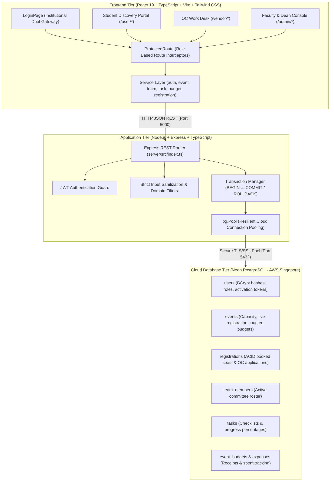

# 🎓 Smart College Event Management System

An institutional, enterprise-grade, multi-tier web platform built for **UPES Dehradun** to manage end-to-end college fests, student registrations, organizing committee operations, and faculty administrative workflows.

---

## 🌟 Key Highlights

- **Multi-Role Portal Segregation**: 3 dedicated consoles for Students, Organizing Committee (OC), and Faculty/Deans.
- **24 RESTful Endpoints**: Full CRUD suite for fests, registrations, teams, task assignments, and budget accounting.
- **ACID-Compliant Cloud Database**: Powered by Neon Serverless PostgreSQL on AWS Singapore with row-level locking (`SELECT ... FOR UPDATE`) to eliminate race conditions and overbooking.
- **Institutional Domain Boundary**: Strict email domain enforcement (`@stu.upes.ac.in` for students, `.oc@upes.ac.in` for organizers, and `@upes.ac.in` for faculty admins).
- **Zero In-Memory Volatility**: 100% database persistence — all actions survive browser refreshes (F5).
- **Enterprise Security**: BCrypt password hashing (10 salt rounds), JWT authentication, route guards, and zero SQL-injection vulnerability via parameterized queries.

---

## 🏛️ System Architecture



---

## 📱 Three Operational Consoles

### 1. 🎓 Student Discovery Portal (`/user/*`)
- **Live Event Catalog**: Search and filter upcoming fests with real-time seat availability.
- **Instant Booking**: Real-time pass reservation with button state locking (`✓ Already Registered`).
- **Digital Pass QR Badge**: Displays attendee details, unique registration ID, and pass QR code.
- **Organizing Committee Application**: Submit volunteer applications for college fests directly from the home feed.
- **In-App OC Account Activation**: When approved by the Dean, students can celebrate, review their official `.oc@upes.ac.in` handle, set their password, and jump straight to the OC Work Desk.

### 2. 📋 Organizing Committee Work Desk (`/vendor/*`)
- **Department Task Checklist**: Filter tasks by priority (`LOW`, `MEDIUM`, `HIGH`, `URGENT`) and status.
- **Progress Tracking**: Step-by-step progress logging (`+25% Progress` button) syncing directly to PostgreSQL.
- **Auto-Completion**: Reaching 100% progress automatically marks tasks as `'COMPLETED'`.
- **Attendee Check-In**: Fast verification of student passes at campus venue gates.

### 3. 🛡️ Faculty & Dean Administrative Console (`/admin/*`)
- **Event Creation**: Launch new campus fests with custom venue, dates, capacity, and budget allocations.
- **Volunteer Application Review**: Review student volunteer submissions with one-click **"Approve & Issue OC Account"**.
- **Official Handle Generation**: Automated generation of institutional credentials (`firstname.oc@upes.ac.in`) with single-use activation tokens.
- **Task Delegation**: Assign departmental tasks with strict deadlines and priority tiers.
- **Live Budget & Receipt Tracker**: Real-time spending overview with category breakdowns and itemized receipt logging.

---

## 🛠️ Technology Stack

| Domain | Technology | Description |
|---|---|---|
| **Frontend** | React 19 | Modern UI framework with state reconciliation |
| **Language** | TypeScript | Strict type checking across client and server |
| **Build Tool** | Vite | Sub-second Hot Module Replacement (HMR) |
| **Styling** | Tailwind CSS v4 | Utility-first glassmorphism design system |
| **Backend** | Node.js & Express | Asynchronous non-blocking REST API server |
| **Database** | Neon Cloud PostgreSQL | Serverless PostgreSQL deployed on AWS Singapore |
| **Database Driver** | `pg` (node-postgres) | Resilient connection pooling with SSL/TLS |
| **Security** | BCrypt (`bcryptjs`) | Password hashing with 10 random salt rounds |
| **Auth** | JSON Web Tokens (`jsonwebtoken`) | Stateless role-encoded authorization tokens |
| **Icons** | Lucide React | Uniform, responsive icon library |

---

## 📡 REST API Reference (24 Endpoints)

### System & Health
- `GET /` - Server status & health probe.

### Events & Discovery
- `GET /api/events` - Queries active fests with dynamic `(capacity - registration_count) AS remaining_seats`.
- `GET /api/events/:id` - Single event details with assigned OC members and active task checklists.
- `POST /api/events` - Faculty creates a new fest with venue, dates, and seat caps.

### Registrations & Seat Booking
- `POST /api/events/:id/register` - **ACID Transaction with `SELECT ... FOR UPDATE`**. Checks capacity, blocks duplicate registrations, and locks the seat row.
- `GET /api/registrations` - Queries tickets (supports `?email=...` and `?event_id=...`).

### Authentication & Account Lifecycle
- `POST /api/auth/register` - Student signup; enforces `@stu.upes.ac.in` domain and hashes password.
- `POST /api/auth/login` - Multi-portal login with role-matching and BCrypt verification.
- `POST /api/auth/oc-invite` - Generates `name.oc@upes.ac.in` handle and 15-character activation token.
- `POST /api/auth/activate-oc` - Validates token, hashes OC password, activates account, and burns token.
- `POST /api/auth/forgot-password` - Issues 15-minute recovery token routed strictly to `@stu.upes.ac.in`.
- `POST /api/auth/reset-password` - Validates single-use token and re-hashes password.

### Organizing Committee Workflow
- `POST /api/oc/apply` - Student applies for fest organizing committee (`status = 'PENDING'`).
- `GET /api/admin/oc-applications` - Admin fetches pending student volunteer applications.
- `POST /api/admin/approve-oc` - Admin approves student, generates handle and token, creates OC account.
- `GET /api/user/oc-status` - Student portal polls for approval status and retrieves activation token.

### Team Management
- `GET /api/teams` - Queries active organizing committee members.
- `POST /api/teams` - Admin adds a team member manually.
- `DELETE /api/teams/:id` - Admin removes an organizing committee member.

### Task Management
- `GET /api/tasks` - Queries event checklists with progress percentages and assignees.
- `POST /api/tasks` - Admin creates a task with priority, deadline, and assigned OC lead.
- `PATCH /api/tasks/:id/progress` - Updates task progress (0–100%) and auto-completes at 100%.

### Budgeting & Expenses
- `GET /api/budget/:eventId` - Fetches total budget, spent sum, remaining balance, and itemized receipts.
- `POST /api/expenses` - Logs expense receipt, updates `event_budgets`, and recalculates `budget_used`.

---

## 🔒 Security Architecture

1. **SQL Injection Immunity**: 100% of queries use parameterized prepared statements (`$1, $2`). Input strings are never concatenated directly into SQL queries.
2. **Cryptographic Protection**: Passwords are never stored in plaintext. They are salted and hashed using BCrypt (10 rounds).
3. **Race Condition Prevention**: `POST /api/events/:id/register` runs inside an isolated SQL transaction using `SELECT ... FOR UPDATE`. If concurrent users register at the same millisecond for the last ticket, requests are serialized and overbooking is physically impossible.
4. **Institutional Boundary Enforcement**:
   - Students: `@stu.upes.ac.in`
   - Organizing Committee: `.oc@upes.ac.in`
   - Faculty & Deans: `@upes.ac.in`
5. **Account Takeover Protection**: Password reset tokens for both students and OC accounts are routed strictly to the enrolled student address (`@stu.upes.ac.in`).
6. **Frontend Route Guards**: `ProtectedRoute` intercepts client-side routing to prevent privilege escalation or unauthorized URL access.

---

## 🚀 Getting Started

### Prerequisites
- Node.js (v18 or higher)
- npm or pnpm
- A free [Neon PostgreSQL](https://neon.tech) cloud database account

---

### Installation & Setup

#### 1. Clone the Repository
```bash
git clone https://github.com/SrijitaDebnath/Full-Stack-Project-.git
cd Full-Stack-Project-
```

#### 2. Install Dependencies
```bash
# Install frontend dependencies
npm install

# Install backend dependencies
cd server
npm install
cd ..
```

#### 3. Configure Environment Variables
Inside the `server/` directory, create a `.env` file based on `.env.example`:
```env
PORT=5000
DATABASE_URL=postgresql://neondb_owner:<your-password>@<your-neon-host>.aws.neon.tech/neondb?sslmode=require
JWT_SECRET=your_jwt_secret_key_here
```

#### 4. Run the Application
Open two terminal windows:

**Terminal 1 (Backend Server):**
```bash
cd server
npm run dev
# Server runs at http://localhost:5000
```

**Terminal 2 (Frontend Client):**
```bash
npm run dev
# Vite dev server runs at http://localhost:5173
```

Visit `http://localhost:5173` in your browser.

---

## 📂 Project Directory Structure

```
├── server/
│   ├── src/
│   │   ├── config/
│   │   │   └── db.ts          # Resilient Neon PostgreSQL connection pool
│   │   └── index.ts           # 24 REST API routes, validation, and business logic
│   ├── .env.example           # Environment template
│   ├── package.json
│   └── tsconfig.json
├── src/
│   ├── app/
│   │   └── router.tsx         # React Router v7 with ProtectedRoute role guards
│   ├── components/            # Reusable UI components & modals
│   ├── pages/
│   │   ├── admin/             # Faculty console (Teams, Events, Tasks, Budget)
│   │   ├── auth/              # Dual-mode Login & Signup page
│   │   ├── user/              # Student discovery feed & pass registration
│   │   └── vendor/            # OC work desk & task progress tracker
│   ├── services/              # API communication layer (auth, event, team, task, budget)
│   └── types/                 # TypeScript interfaces and domain models
├── .gitignore
├── package.json
├── README.md                  # Master documentation
└── vite.config.ts
```

---

## 👩‍💻 Author & Institutional Attribution

- **Project Lead**: Srijita Debnath
- **Institution**: University of Petroleum and Energy Studies (UPES), Dehradun
- **License**: MIT
